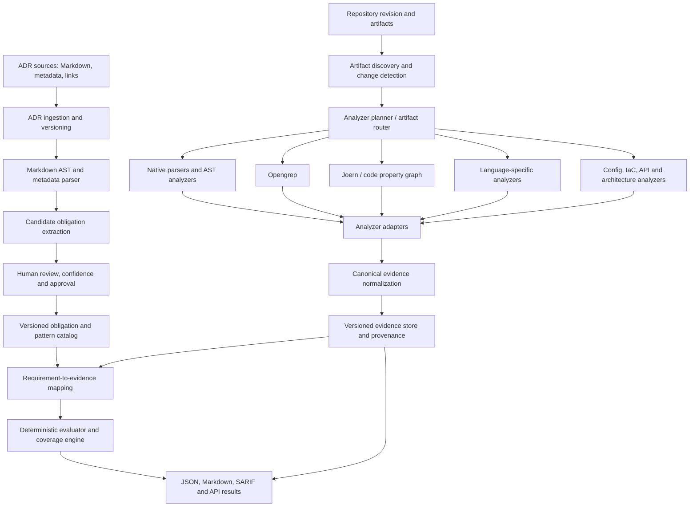

# Scalable Pathfinder Architecture

## Purpose and design principles

Pathfinder evaluates architectural decisions against repository evidence. It must scale from the current deterministic Go MVP to thousands of ADRs across repositories and languages without requiring one bespoke verifier per ADR.

Core principles:

1. **Normalize once, evaluate many times.** Every analyzer emits a shared evidence model. ADR requirement patterns consume normalized evidence rather than vendor-specific output.
2. **Separate interpretation from enforcement.** ADR ingestion proposes obligations and pattern mappings; enforcement runs versioned, approved interpretations. Runtime evaluation does not need an LLM.
3. **Reuse capabilities, not contracts.** Thousands of ADRs should map to a much smaller catalog of reusable verification patterns and analyzers.
4. **Analyze once per revision.** Run relevant tools per repository commit and reuse their evidence across all in-scope ADRs.
5. **Absence of findings is not proof.** Every analyzer reports scope, coverage, errors, tool version, and provenance. Missing or unsupported evidence never becomes PASS.
6. **Keep provenance and reproducibility.** Preserve source locations, analyzer/config versions, input revision, raw artifacts, normalized evidence, and policy/ADR versions.
7. **Open-source first, license-aware.** Prefer mature open-source analyzers and parsers. Review the engine, rules, plugins, and transitive dependency licenses separately.

## Logical architecture

This is a logical architecture, not a requirement to deploy every box as a separate service. The current Go CLI can implement the core contracts first. In AWS, ingestion, orchestration, analyzer execution, evidence storage, and reporting can scale independently.

## ADR corpus ingestion: scale to thousands of ADRs

### Ingestion pipeline

1. Discover ADR Markdown and metadata in configured repositories and approved sources.
2. Parse Markdown with an AST library such as **goldmark** in Go. Preserve headings, paragraphs, lists, tables, code blocks, links, file path, line ranges, and source revision.
3. Extract candidate decisions, obligations, constraints, scope, rationale, exceptions, dependencies, and verification hints. This may use deterministic extraction first and optional batch LLM-assisted extraction for ambiguous prose.
4. Normalize candidate obligations into a stable intermediate representation.
5. Cluster semantically similar obligations and suggest existing verification patterns. Clustering is a suggestion mechanism, not automatic proof that two obligations are equivalent.
6. Generate a review package showing the original text, extracted obligation, proposed pattern, scope, confidence, evidence requirements, and unresolved ambiguities.
7. Require approval for new or materially changed enforcement interpretations before they become active.
8. Version and hash the source ADR, extracted interpretation, pattern mapping, and approval. An ADR text change triggers re-extraction/review only for affected content and mappings.

### Do not create one contract per ADR by default

Use three distinct layers:

- **ADR record:** the original decision, rationale, owner, status, scope, exceptions, links, version, and source provenance.
- **Obligation record:** one assessable statement derived from an ADR, with modality (MUST/SHOULD/MAY or equivalent), affected entities, scope, evidence needs, confidence, and review state.
- **Verification pattern:** reusable logic such as import boundary, required configuration, dependency restriction, API compatibility, gateway path, async communication preference, encryption policy, or architecture relationship constraint.

Many ADR obligations can map to the same pattern. One ADR can also produce multiple obligations, and one obligation can require evidence from several analyzers.

### Obligation types and enforcement strength

| Type | Example | Appropriate treatment |
| --- | --- | --- |
| Exact structural constraint | Package A must not import package B | Deterministic AST/import graph check |
| Configuration constraint | Timeout must be within a range | Typed config parser and deterministic rule |
| Technology/dependency constraint | Service must not depend on a disallowed library | Lockfile/package graph analyzer |
| Architecture relationship | External ingress must pass through the approved gateway | Architecture graph evidence plus graph policy |
| Behavioral/semantic principle | Prefer asynchronous messaging to reduce coupling | Evidence-backed assessment; often review-required unless a concrete proxy is approved |
| Rationale/context | Decision was made to reduce operational risk | Preserve as context; do not invent a pass/fail check |

A semantic principle such as “prefer async messaging” must not be converted automatically into a hard failure merely because synchronous calls are found. The approved interpretation should define scope, exceptions, observable proxies, evidence requirements, and whether the outcome can be PASS/FAIL or only REVIEW_REQUIRED/INDETERMINATE.

## Composite analyzer strategy

Composite analyzers are first-class. A composite is a versioned analyzer bundle that runs one or more underlying tools, collects their raw outputs, and emits normalized evidence. Pathfinder should not require all checks to run inside one binary or one container.

### Recommended initial tool families

| Capability | Candidate | Primary role | Notes |
| --- | --- | --- | --- |
| Multi-language structural patterns | **Opengrep** | Pattern-based source checks; JSON/SARIF output | Primary Semgrep-compatible candidate. Pin versions and rules; audit rule-pack licenses independently from engine license. |
| Deep code relationships/data flow | **Joern** | Code property graphs and cross-function/cross-file queries | Use selectively for obligations that need graph/data-flow evidence; heavier execution profile. |
| Go security | **gosec** | Go-specific security findings | Treat as one evidence producer, not a complete architecture verifier. |
| Python security | **Bandit** | Python-specific security findings | Same normalized adapter contract as other tools. |
| Java security | **SpotBugs + Find Security Bugs** | Bytecode and Java security analysis | Run only for relevant language/build artifacts. |
| Native language structure | Go standard library parser; tree-sitter where useful | Fast syntax, import, and structural evidence | Prefer native parsers for precise language facts. |
| Architecture and policy | OPA/Conftest where appropriate; custom graph policies only where no reusable tool fits | Evaluate structured policy/relationship evidence | Keep policy inputs normalized and versioned. |
| Configuration and interface artifacts | Parsers for JSON/YAML, OpenAPI, Terraform/IaC, dependency manifests and lockfiles | Configuration, API, infrastructure, and dependency evidence | Choose maintained tools per artifact family rather than a single universal scanner. |

The list is a candidate stack, not a mandate to install every tool. Start with the analyzers needed by the pilot ADR corpus. Benchmark accuracy, language coverage, runtime, memory, output quality, deployment friction, and license posture before adding a tool. Do not run multiple tools that provide redundant coverage by default unless overlap is intentional and measured.

### Composite examples

- **Source structure composite:** native AST/import analysis + Opengrep. Use Joern only when cross-file/data-flow evidence is required.
- **Language security composite:** language detector + gosec/Bandit/SpotBugs-family tool + optional Opengrep rules.
- **Dependency composite:** ecosystem manifest/lockfile parser + dependency policy and vulnerability metadata source.
- **Cloud architecture composite:** Terraform/IaC parser + normalized resource/relationship graph + OPA or deterministic graph rules.
- **API contract composite:** OpenAPI parser + schema/compatibility checks + route-to-service evidence if available.
- **Semantic architecture composite:** deterministic evidence collection first; optional batch interpretation or assisted review; no unsupported automatic PASS.

Each composite declares its input artifact types, required environment, supported languages, tools and versions, configuration/rule-set hashes, expected outputs, resource profile, timeout, and failure behavior.

## Canonical normalized evidence contract

Raw scanner output is retained as an artifact. Adapters translate it into a stable internal schema so downstream policy evaluation is independent of analyzer vendors.

A normalized evidence record should contain:

- `schema_version`
- `evidence_id` (stable within an analysis run)
- `repository`, `revision`, and `analysis_run_id`
- `artifact_path`, artifact digest, language/format, and source range when available
- `producer`: analyzer name, version, adapter version, composite ID, rule ID, rule/config digest
- `kind`: syntax fact, dependency edge, call/data-flow edge, configuration value, API operation, infrastructure resource/relationship, scanner finding, or analysis limitation
- `subject`, `predicate`, and `object` where evidence can be represented as a relationship
- `observation`: typed value or structured payload
- `finding`: normalized rule identifier, severity, message, and remediation metadata when applicable
- `confidence` and its meaning, where the producer can support it; never fabricate confidence
- `provenance`: source location, raw artifact reference, extraction method, and transformation chain
- `scope`: files, modules, packages, services, or artifact classes analyzed
- `status`: observed, absent-within-declared-scope, unsupported, parse-error, tool-error, or incomplete
- `limitations` and `diagnostics`

Keep the canonical schema deliberately small and extensible. Tool-specific fields may be preserved under namespaced metadata, but must not become required fields for all analyzers.

### Normalization rules

1. Map equivalent severities and result states to a shared vocabulary while preserving original values.
2. Normalize paths relative to the repository revision; retain original path and source range.
3. Deduplicate only when producer, rule semantics, location, and evidence meaning support deduplication. Preserve links to all contributing records.
4. Keep findings separate from facts. A scanner alert is not automatically proof of an ADR violation; the evaluator must map it to an approved obligation.
5. Preserve analyzer errors and partial scope explicitly. Empty output is not synonymous with complete clean output.
6. Store raw outputs for audit/reprocessing, with content hashes and retention policy.
7. Make adapter versions and schema migrations explicit. Never silently reinterpret historical evidence.

## Applicability, coverage, and assessment semantics

Coverage must be calculated across the accepted ADR/obligation inventory, not only the subset that happened to produce a finding.

Recommended obligation outcomes:

- `PASS`: applicable obligation evaluated with sufficient evidence and no violation.
- `FAIL`: applicable obligation has evidence meeting the approved violation criteria.
- `NOT_APPLICABLE`: approved scope rule proves the obligation does not apply.
- `EVIDENCE_MISSING`: expected evidence was not supplied or discovered.
- `UNSUPPORTED`: no configured analyzer/pattern can assess this obligation or artifact type.
- `REVIEW_REQUIRED`: interpretation is ambiguous or evidence requires a human decision.
- `INDETERMINATE`: analysis could not establish a trustworthy outcome.
- `ERROR`: adapter or evaluator execution failed.

Do not collapse `EVIDENCE_MISSING`, `UNSUPPORTED`, `REVIEW_REQUIRED`, or `INDETERMINATE` into PASS. Report at least:

- ADRs discovered, accepted, excluded, and awaiting interpretation review
- obligations in scope and their outcomes
- obligations with active verification-pattern mappings
- analyzer coverage by artifact type/language and declared scope
- missing evidence, unsupported patterns, and tool failures
- evidence age/revision and stale-result counts

The existing MVP's COMPLETE/PARTIAL/NONE status is useful for its current catalog, but at scale it must be complemented by corpus-level interpretation coverage and obligation-level outcome counts. A report can have no detected violations and still be incomplete.

## AWS deployment direction

Use managed orchestration and isolated analyzer workers; do not couple the core evaluator to a particular cloud service.

### Suggested flow

1. **Ingestion:** repository webhooks or scheduled sync publish ADR/revision events.
2. **Event routing:** EventBridge routes ADR changes, commits, and assessment requests.
3. **Orchestration:** Step Functions coordinates discovery, analyzer planning, parallel composite jobs, normalization, mapping, evaluation, and report generation.
4. **Execution:** AWS Batch or ECS/Fargate runs heavyweight/long-running analyzers such as Joern; Lambda handles short orchestration, lightweight parsing, routing, and small transformations where limits permit.
5. **Artifact/evidence storage:** S3 stores immutable raw outputs, normalized evidence bundles, reports, and content-addressed artifacts. Apply encryption, access controls, lifecycle policies, and retention appropriate to audit needs.
6. **Catalog and run metadata:** a transactional store such as DynamoDB or Aurora tracks ADR versions, obligations, mappings, analyzer manifests, run state, evidence pointers, approvals, and idempotency keys. Select based on query and relational needs; do not require a vector database for deterministic evaluation.
7. **Search/semantic retrieval:** optional index for finding related ADRs and candidate pattern mappings. Retrieval proposes candidates; it does not establish compliance.
8. **Reporting/integration:** publish JSON/Markdown/SARIF and integrate with GitHub checks/issues or an internal API.

### AWS execution boundaries

- Run analyzers in isolated, least-privilege workers with no production credentials and minimal network egress.
- Treat repository code, build scripts, issue bodies, and analyzer output as untrusted.
- Prefer static parsing. Do not build or execute untrusted projects by default; if a tool requires builds, use a separate sandbox and explicit policy.
- Pin container images by digest and tools by version; produce an analyzer manifest for each run.
- Use bounded concurrency, per-tool CPU/memory/time budgets, retries only for transient failures, and dead-letter handling.
- Make tasks idempotent using repository revision + artifact digest + analyzer/config version.
- Cache evidence for unchanged artifacts and compatible analyzer configurations; invalidate on relevant input, rule, adapter, or tool-version changes.
- Use separate roles/buckets/prefixes and access boundaries for raw artifacts, normalized evidence, catalog/approval data, and reports.
- Keep secrets out of evidence and logs; redact tokens and sensitive source excerpts as appropriate.
- Emit metrics for queue age, runtime, timeout/error rate, cache hit rate, analyzer cost, evidence coverage, and mapping quality.

## Data flow and caching

Run discovery once per revision, then schedule only composites relevant to changed artifact types and active obligations. A composite may emit evidence consumed by hundreds of obligations. Cache keys should include the repository revision or artifact digest, analyzer/container version, rule/config digest, adapter version, and relevant options. A cached result is reusable only when all semantically relevant inputs match.

For large repositories, support incremental analysis and periodic full scans. Incremental reports must state their scope and reference the baseline/full-scan freshness. A skipped analyzer is not a clean result.

## API and interface direction

Keep the current CLI and issue workflow as the first execution surface. Introduce stable internal interfaces before splitting services:

- `Analyzer`: declares capabilities and accepts an analysis request; returns raw artifact references plus diagnostics.
- `Normalizer`: maps producer output to canonical evidence.
- `PatternEvaluator`: evaluates an approved obligation pattern against evidence.
- `CatalogProvider`: serves versioned ADRs, obligations, patterns, and scope.
- `AssessmentOrchestrator`: plans jobs, manages idempotency, merges evidence, computes coverage, and builds reports.

A future API can expose a single evaluation endpoint, with separate endpoints for translation/normalization and direct evaluation of already-normalized architecture/evidence models. Keep API contracts versioned; the cloud deployment should call the same core contracts as the CLI.

## Rollout plan

### Phase 1 — Stabilize the contracts
- Preserve the Go MVP and its deterministic verifier behavior.
- Define versioned normalized evidence and analyzer manifests.
- Add explicit applicability reasons and evidence-missing/unsupported/review-required outcomes.
- Add adapter contract tests and fixture-based reproducibility tests.

### Phase 2 — Prove composite analyzers
- Add one Opengrep composite and one native AST/config composite.
- Normalize outputs to JSON evidence and SARIF.
- Evaluate gosec/Bandit/Java analyzers only when representative repositories require them.
- Benchmark Joern on a narrow cross-file/data-flow use case before adopting it broadly.
- Document licenses for engines, rules, plugins, and transitive dependencies.

### Phase 3 — Prove ADR reuse
- Select 100–200 representative ADRs across exact, structural, dependency, architecture-graph, and semantic categories.
- Extract candidate obligations, map them to patterns, and review with architecture/security owners.
- Measure extraction precision, missed obligations, pattern reuse, review effort, false-positive rate, and percentage that can be deterministically assessed.
- Expand only after the review process and outcome semantics are reliable.

### Phase 4 — AWS orchestration
- Package analyzers as pinned, isolated container images.
- Add event-driven orchestration, bounded parallel execution, S3 evidence artifacts, metadata store, and operational metrics.
- Validate idempotency, retries, cache invalidation, permissions, audit retention, and cost per repository/revision.

### Phase 5 — Scale the corpus
- Import additional ADRs in batches, deduplicate candidate patterns, and prioritize high-risk/high-reuse obligations.
- Revisit interpretation mappings when source ADRs, analyzer rules, or evidence schemas change.
- Publish corpus-level coverage and confidence/limitations, not only a pass/fail headline.

## Acceptance criteria for the design

- Two different analyzers can emit equivalent normalized evidence without changing evaluator logic.
- An analyzer timeout or unsupported file type cannot produce a false PASS.
- A single normalized fact can be reused by multiple obligations and ADRs.
- An ADR can map to multiple reusable patterns; a pattern can map to many ADRs.
- Every result is reproducible from pinned inputs and versioned configuration.
- A semantic obligation with no approved observable proxy remains REVIEW_REQUIRED or INDETERMINATE.
- The report distinguishes no violations found from complete coverage of the ADR corpus and repository scope.
- The AWS worker model can scale analyzers independently while preserving the same evidence contract as local CI.
